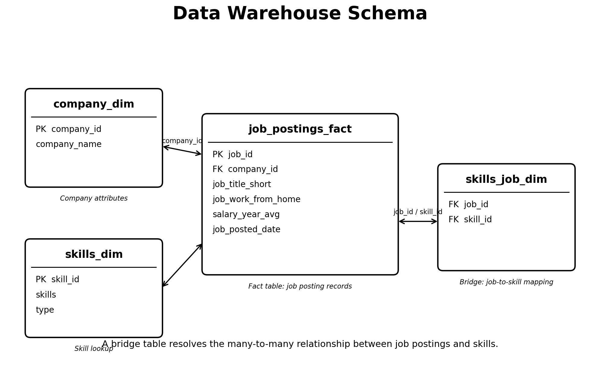
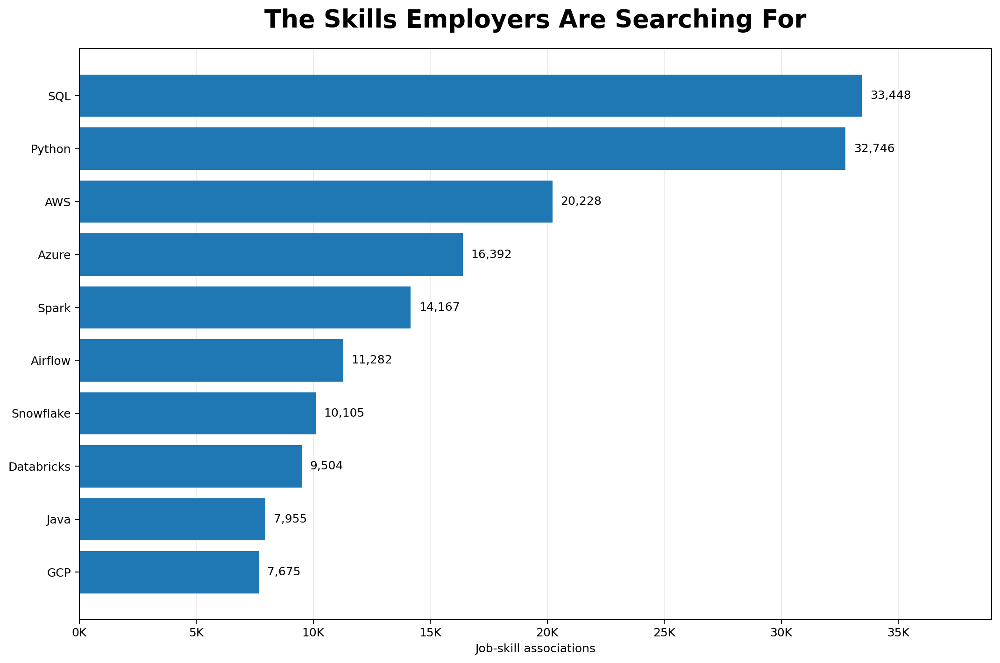
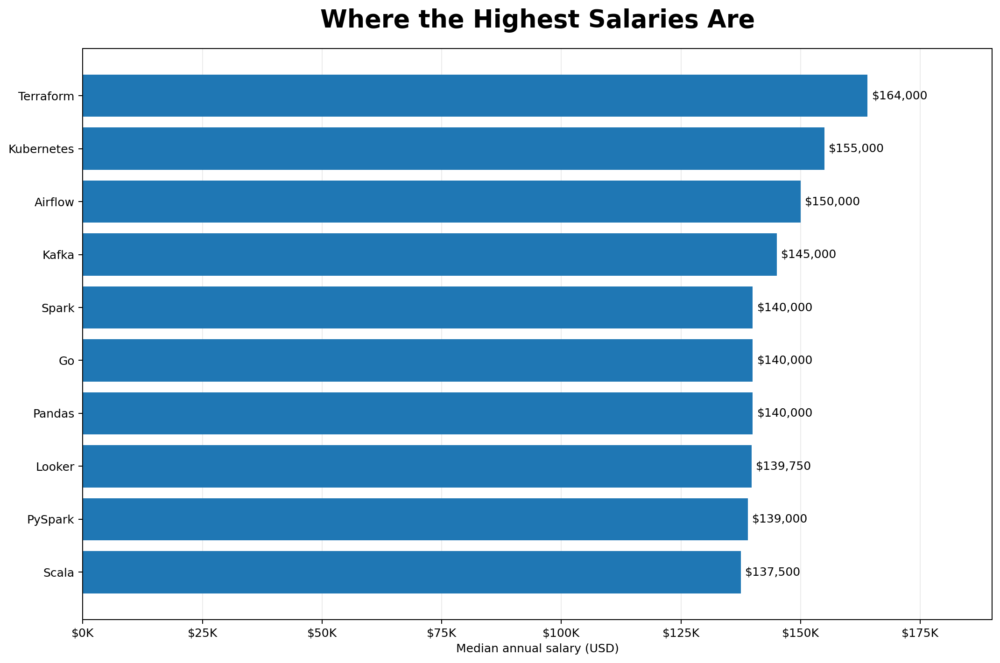
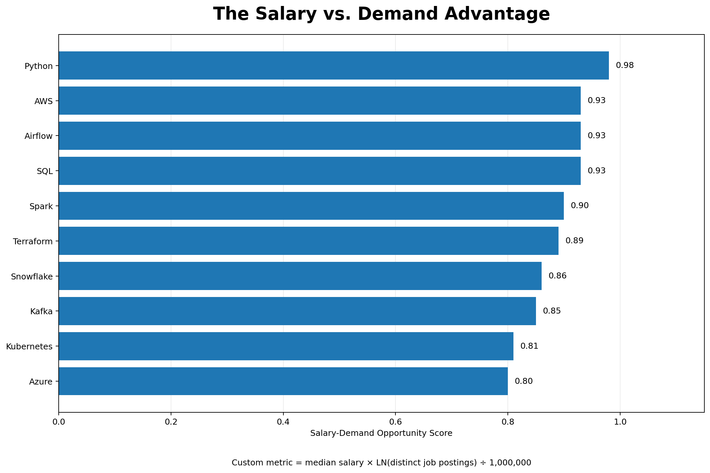

# The Data Engineering Job Market

### A SQL-Driven Analysis of Skills, Salaries, and Remote Job Opportunities


---

## Executive Summary

What skills are employers looking for when hiring Data Engineers? Which technologies are associated with the highest salaries? And which skills offer the strongest combination of job demand and compensation?

This project explores the remote Data Engineering job market using SQL and DuckDB. By analyzing job postings from 2023 to the present, I identified the most frequently requested technical skills, compared median salaries across technologies, and developed a custom metric to evaluate the relationship between salary and demand.

The analysis focuses on three core areas:

- **Skill Demand:** Identify the technical skills most frequently requested by employers.
- **Salary Analysis:** Find the skills associated with the highest median salaries.
- **Salary vs. Demand:** Evaluate which skills combine competitive compensation with strong employer demand.

A logarithmic transformation is also used to compare demand while reducing the effect of large differences in posting counts.

### Key Findings

- SQL and Python lead the market, each appearing in approximately 33,000 remote Data Engineer job-skill associations.
- Terraform, Kubernetes, and Airflow are among the highest-paying skills in the dataset.
- Python, AWS, SQL, and Airflow rank highly when salary and demand are considered together.
- The results suggest that a combination of foundational programming, cloud infrastructure, and data orchestration skills can be valuable in the Data Engineering job market.

---

## 1. Problem & Context

The Data Engineering field continues to evolve as organizations invest in cloud infrastructure, data pipelines, automation, and large-scale data processing.

For aspiring Data Engineers, choosing which technologies to learn can be difficult. A skill may command a high salary but appear in relatively few job postings. Another may be requested by thousands of employers but offer a lower median salary.

This analysis addresses three central questions:

1. Which technical skills are most in demand?
2. Which skills are associated with the highest median salaries?
3. Which skills offer the strongest balance between compensation and demand?

The goal is to turn job-posting data into practical insights that can help guide technical learning and career development.

## 2. Dataset & Methodology

**Data source:** [DataNerd.tech](https://datanerd.tech/)

| Dataset Detail | Description |
|---|---|
| Historical Coverage | 2023–Present |
| Collection Date | November 14, 2026 |
| Update Frequency | Daily |
| Job Category | Data Engineer |
| Work Arrangement | Remote |
| Database | DuckDB |

The dataset is updated daily, so the results represent a snapshot of the job market as of the collection date. Counts and rankings may change as new job postings are added.

### Methodology

The analysis uses SQL to:

- Join job postings with skill lookup and mapping tables.
- Filter for remote Data Engineer positions.
- Aggregate job-skill relationships.
- Calculate median annual salaries.
- Count distinct job postings where appropriate.
- Apply logarithmic transformations to demand counts.
- Develop a comparative salary-demand opportunity score.

**Important counting distinction:** A job posting can list multiple skills. Therefore, some analyses count job-skill associations, while others count distinct job postings. Salary-based analyses also exclude postings without an annual salary value.

## 3. Data Warehouse Schema

The analysis uses a relational data warehouse with a fact table, dimension tables, and a bridge table connecting job postings to their associated skills.



| Table | Type | Purpose |
|---|---|---|
| `job_postings_fact` | Fact | Contains job posting details, including titles, salaries, dates, and work arrangements. |
| `skills_dim` | Dimension | Contains skill names and identifiers. |
| `skills_job_dim` | Bridge | Connects job postings to their associated skills. |
| `company_dim` | Dimension | Contains company information. |

The `skills_job_dim` table resolves the many-to-many relationship between job postings and skills. One job posting can require multiple skills, and one skill can appear across many job postings.

## 4. Tech Stack

| Technology | Purpose |
|---|---|
| SQL | Data querying, filtering, joins, and analysis |
| DuckDB | Database engine |
| VS Code | SQL development environment |
| Git & GitHub | Version control and project documentation |
| Markdown | README documentation |

## 5. Repository Structure

```text
Data_Engineering_Projects/
│
├── 1_EDA/
│   ├── 0_update_dataset.sql
│   ├── 01_top_demanded_skills.sql
│   ├── 02_top_paying_skills.sql
│   ├── 03_optimal_skills.sql
│   │
│   ├── Data Engineer project image.png
│   ├── data-warehouse-schema.png
│   ├── top_demanded_skills.png
│   ├── top_paying_skills.png
│   └── optimal_skills.png
│
└── README.md
```

The 1_EDA folder contains the SQL scripts used to update the dataset and perform the analysis, along with the project header image and visualizations. The README links directly to these files.

## 6. Analysis & Results

### 01 — The Skills Employers Are Searching For

**Business question:** Which technical skills appear most frequently in remote Data Engineer job postings?

To identify the most requested skills, I joined the job postings table to the skill mapping and lookup tables. I then counted the job-skill associations for each technology.

**SQL query:**

```sql
SELECT
    sd.skills,
    COUNT(jpf.*) AS demand_count
FROM data_jobs_bonus.job_postings_fact AS jpf
INNER JOIN data_jobs_bonus.skills_job_dim AS sjd
    ON jpf.job_id = sjd.job_id
INNER JOIN data_jobs_bonus.skills_dim AS sd
    ON sjd.skill_id = sd.skill_id
WHERE
    jpf.job_title_short = 'Data Engineer'
    AND jpf.job_work_from_home = TRUE
GROUP BY sd.skills
ORDER BY demand_count DESC
LIMIT 10;
```

[View SQL Query](01_top_demanded_skills.sql)

**Results:**

| Rank | Skill | Demand Count |
|---:|---|---:|
| 1 | SQL | 33,448 |
| 2 | Python | 32,746 |
| 3 | AWS | 20,228 |
| 4 | Azure | 16,392 |
| 5 | Spark | 14,167 |
| 6 | Airflow | 11,282 |
| 7 | Snowflake | 10,105 |
| 8 | Databricks | 9,504 |
| 9 | Java | 7,955 |
| 10 | GCP | 7,675 |

**Key Insights:**

- SQL and Python are the two most frequently requested skills, with demand counts exceeding 32,000 each.
- AWS and Azure demonstrate the importance of cloud platforms in Data Engineering.
- Spark and Airflow highlight the demand for distributed data processing and workflow orchestration.
- Snowflake and Databricks also feature prominently, reflecting the importance of modern data platforms.



### 02 — Where the Highest Salaries Are

**Business question:** Which technical skills are associated with the highest median salaries?

For this analysis, I filtered out job postings without an annual salary value and focused on remote Data Engineer positions. I calculated the median annual salary for each skill and limited the results to skills with more than 100 job-skill associations.

**SQL query:**

```sql
SELECT
    sd.skills,
    COUNT(sd.skills) AS skill_count,
    ROUND(MEDIAN(jpf.salary_year_avg), 0) AS median_salary
FROM data_jobs_bonus.job_postings_fact AS jpf
INNER JOIN data_jobs_bonus.skills_job_dim AS sjd
    ON jpf.job_id = sjd.job_id
INNER JOIN data_jobs_bonus.skills_dim AS sd
    ON sjd.skill_id = sd.skill_id
WHERE
    jpf.job_title_short = 'Data Engineer'
    AND jpf.salary_year_avg IS NOT NULL
    AND jpf.job_work_from_home = TRUE
GROUP BY sd.skills
HAVING COUNT(sd.skills) > 100
ORDER BY median_salary DESC
LIMIT 25;
```

[View SQL Query](02_top_paying_skills.sql)

**Results:**

| Rank | Skill | Skill Count | Median Salary |
|---:|---|---:|---:|
| 1 | Terraform | 226 | $164,000 |
| 2 | Kubernetes | 189 | $155,000 |
| 3 | Airflow | 499 | $150,000 |
| 4 | Kafka | 351 | $145,000 |
| 5 | Go | 157 | $140,000 |
| 6 | Spark | 620 | $140,000 |
| 7 | Pandas | 114 | $140,000 |
| 8 | Looker | 106 | $139,750 |
| 9 | PySpark | 209 | $139,000 |
| 10 | Scala | 292 | $137,500 |
| 11 | Git | 255 | $137,000 |
| 12 | Java | 360 | $135,790 |
| 13 | GCP | 252 | $135,000 |
| 14 | AWS | 972 | $135,000 |
| 15 | Python | 1,385 | $135,000 |
| 16 | Docker | 176 | $135,000 |
| 17 | Snowflake | 566 | $135,000 |
| 18 | MongoDB | 158 | $135,000 |
| 19 | NoSQL | 222 | $134,708 |
| 20 | Hadoop | 220 | $132,603 |
| 21 | R | 145 | $132,500 |
| 22 | Databricks | 383 | $129,500 |
| 23 | SQL | 1,407 | $127,962 |
| 24 | Redshift | 333 | $127,600 |
| 25 | BigQuery | 179 | $127,500 |

**Key Insights:**

- Terraform ranks first with a median annual salary of $164,000.
- Kubernetes and Airflow also demonstrate strong salary potential.
- Kafka, Spark, and PySpark show the value associated with data processing and streaming technologies.
- SQL and Python have lower median salaries than some specialized technologies, but appear in substantially more job-skill associations.
  


### 03 — The Salary vs. Demand Advantage

**Business question:** Which skills offer the strongest combination of compensation and job demand?

A high median salary does not necessarily mean a skill is widely requested. Similarly, a frequently requested skill may not command the highest compensation.

To compare these factors, I created a custom metric called the **Salary-Demand Opportunity Score**.

**Formula:**

\[
\text{Opportunity Score} =
\frac{\text{Median Salary} \times \ln(\text{Demand Count})}{1,000,000}
\]

The score combines median annual salary with the natural logarithm of the number of distinct job postings associated with each skill.

This is a custom comparative metric developed for this project. It is not a percentage, probability, or standardized industry measure.

**SQL query:**

```sql
SELECT
    sd.skills,
    ROUND(MEDIAN(jpf.salary_year_avg), 1) AS median_salary,
    COUNT(DISTINCT jpf.job_id) AS demand_count,
    ROUND(LN(COUNT(DISTINCT jpf.job_id)), 2) AS ln_demand_count,
    ROUND(
        LN(COUNT(DISTINCT jpf.job_id))
        * MEDIAN(jpf.salary_year_avg) / 1000000,
        2
    ) AS salary_demand_opportunity_score
FROM data_jobs_bonus.job_postings_fact AS jpf
INNER JOIN data_jobs_bonus.skills_job_dim AS sjd
    ON jpf.job_id = sjd.job_id
INNER JOIN data_jobs_bonus.skills_dim AS sd
    ON sjd.skill_id = sd.skill_id
WHERE
    jpf.job_title_short = 'Data Engineer'
    AND jpf.salary_year_avg IS NOT NULL
    AND jpf.job_work_from_home = TRUE
GROUP BY sd.skills
HAVING COUNT(DISTINCT jpf.job_id) >= 100
ORDER BY salary_demand_opportunity_score DESC
LIMIT 25;
```

[View SQL Query](03_optimal_skills.sql)

**Results:**

| Rank | Skill | Median Salary | Demand Count | LN Demand | Opportunity Score |
|---:|---|---:|---:|---:|---:|
| 1 | Python | $135,000 | 1,385 | 7.23 | 0.98 |
| 2 | AWS | $135,000 | 972 | 6.88 | 0.93 |
| 3 | SQL | $127,962 | 1,407 | 7.25 | 0.93 |
| 4 | Airflow | $150,000 | 499 | 6.21 | 0.93 |
| 5 | Spark | $140,000 | 620 | 6.43 | 0.90 |
| 6 | Terraform | $164,000 | 226 | 5.42 | 0.89 |
| 7 | Snowflake | $135,000 | 566 | 6.34 | 0.86 |
| 8 | Kafka | $145,000 | 351 | 5.86 | 0.85 |
| 9 | Kubernetes | $155,000 | 189 | 5.24 | 0.81 |
| 10 | Azure | $125,000 | 616 | 6.42 | 0.80 |
| 11 | Java | $135,790 | 360 | 5.89 | 0.80 |
| 12 | Scala | $137,500 | 292 | 5.68 | 0.78 |
| 13 | Databricks | $129,500 | 383 | 5.95 | 0.77 |
| 14 | Git | $137,000 | 255 | 5.54 | 0.76 |
| 15 | GCP | $135,000 | 252 | 5.53 | 0.75 |
| 16 | PySpark | $139,000 | 209 | 5.34 | 0.74 |
| 17 | Redshift | $127,600 | 333 | 5.81 | 0.74 |
| 18 | NoSQL | $134,708 | 222 | 5.40 | 0.73 |
| 19 | Hadoop | $132,603 | 220 | 5.39 | 0.72 |
| 20 | Go | $140,000 | 157 | 5.06 | 0.71 |
| 21 | Docker | $135,000 | 176 | 5.17 | 0.70 |
| 22 | Pandas | $140,000 | 114 | 4.74 | 0.66 |
| 23 | BigQuery | $127,500 | 179 | 5.19 | 0.66 |
| 24 | R | $132,500 | 145 | 4.98 | 0.66 |
| 25 | SQL Server | $121,920 | 200 | 5.30 | 0.65 |

**Key Insights:**

- Python ranks first with an opportunity score of 0.98, combining a $135,000 median salary with substantial demand.
- AWS, SQL, and Airflow follow closely, each scoring 0.93.
- Terraform has the highest median salary in this analysis, but its lower demand count places it below several more frequently requested technologies.
- Evaluating salary and demand together provides a different perspective than looking at either metric independently.



### Understanding Logarithmic Demand

The optimal skills analysis also uses the natural logarithm (`LN`) to transform demand counts.

For example:

- `LN(100) ≈ 4.61`
- `LN(1,000) ≈ 6.91`
- `LN(10,000) ≈ 9.21`

A tenfold increase in demand adds approximately 2.30 to the natural logarithm. This compresses large values while preserving their relative order.

The transformation is useful for comparing demand without allowing large raw counts to dominate the numerical range. It does not convert demand into a percentage.

## 7. Key Takeaways

**1. SQL and Python are foundational.**

Both skills consistently rank at or near the top of the demand analysis. Their prevalence makes them strong foundational technologies for aspiring Data Engineers.

**2. Cloud platforms are central to the market.**

AWS, Azure, and GCP appear prominently in the demand results, reinforcing the importance of cloud infrastructure knowledge.

**3. Specialized infrastructure skills can command higher salaries.**

Terraform, Kubernetes, Airflow, and Kafka rank highly in median salary. These technologies are associated with infrastructure management, orchestration, and distributed data systems.

**4. Demand and compensation tell different stories.**

A skill with a high median salary is not necessarily the most frequently requested. The custom opportunity score helps compare both dimensions in one metric.

**5. Foundational and specialized skills complement one another.**

The results suggest that SQL and Python provide a strong foundation, while cloud platforms, orchestration, and distributed processing technologies can expand a Data Engineer's technical toolkit.

## 8. SQL Skills Demonstrated

| Skill | Application |
|---|---|
| INNER JOIN | Connecting fact, dimension, and bridge tables |
| GROUP BY | Aggregating results by skill |
| WHERE | Filtering remote Data Engineer postings |
| HAVING | Filtering aggregated skill groups |
| COUNT | Measuring job-skill associations |
| COUNT DISTINCT | Counting unique job postings |
| MEDIAN | Calculating median annual salaries |
| ROUND | Formatting analytical results |
| ORDER BY | Ranking skills |
| LIMIT | Returning focused result sets |
| LN | Applying natural logarithmic transformations |
| Calculated Metrics | Developing a salary-demand opportunity score |

## 9. Limitations & Considerations

- **Dataset coverage:** The analysis covers the available DataNerd.tech dataset from 2023 to the collection date. It is not necessarily a complete representation of every Data Engineer job posting.
- **Daily updates:** The dataset changes over time, so future results may differ from this snapshot.
- **Salary availability:** Salary-based analyses exclude postings where `salary_year_avg` is NULL. This may introduce differences between demand and salary rankings.
- **Job-skill associations:** A single posting can list multiple skills. Counts of skill associations should not be interpreted as unique job posting counts.
- **Distinct job counts:** The opportunity score uses distinct job posting counts for each skill.
- **Remote-only scope:** The analysis focuses on remote Data Engineer roles and does not represent the entire Data Engineering job market.
- **Custom opportunity score:** The formula is an exploratory metric created for this project. It is not a standardized measure of career value, salary growth, or hiring probability.

## 10. Project Conclusion

This analysis demonstrates how SQL can be used to transform raw job-posting data into insights about the skills, technologies, and compensation trends shaping the Data Engineering market.

By combining relational joins, aggregation, median salary calculations, distinct counts, and logarithmic transformations, I explored the relationship between technical skill demand and earning potential.

The findings point to SQL and Python as foundational skills, cloud platforms as important components of the modern data stack, and specialized technologies such as Terraform, Kubernetes, and Airflow as valuable areas for further exploration.

More importantly, this project demonstrates how data can be used to answer practical business questions and support more informed career decisions.

---

## Project Links

- **GitHub Repository:** [Data Engineering Job Market](./)
- **SQL Queries:** [Browse the 1_EDA folder](./1_EDA/)
- **Dataset Update Script:** [0_update_dataset.sql](./1_EDA/0_update_dataset.sql)
- **Visualizations:**
  - [Project Header Image](./Images/Data%20Engineer%20project%20image.png)
  - [Data Warehouse Schema](./Images/data-warehouse-schema.png)
  - [Top Demanded Skills](./Images/top_demanded_skills.png)
  - [Top Paying Skills](./Images/top_paying_skills.png)
  - [Optimal Skills](./Images/optimal_skills.png)
- **Dataset:** [DataNerd.tech](https://datanerd.tech/)

## Author

Amoni Haynes

Data Analytics | SQL | Data Engineering

[LinkedIn](https://www.linkedin.com/in/amoni-haynes-0b0bb6154/) · [GitHub](https://github.com/AmoniH12-3)